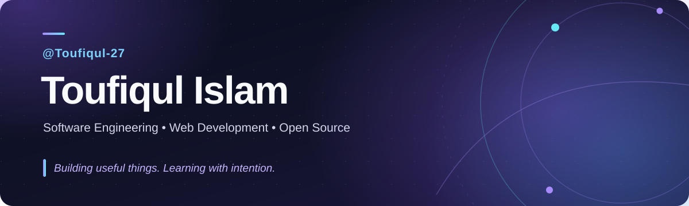

  

  

    <a href="https://github.com/Toufiqul-27/Portfolio"><b>Portfolio</b></a>
    &nbsp; · &nbsp;
    <a href="https://www.linkedin.com/in/toufiqul-islam-0624b7402/"><b>LinkedIn</b></a>
    &nbsp; · &nbsp;
    <a href="https://github.com/Toufiqul-27?tab=repositories"><b>All repositories</b></a>
  

### Hello, I'm Toufiqul

I'm a **Computer Science & Engineering student at Southeast University, Bangladesh**, interested in backend engineering, full-stack web development and open-source software.

I enjoy learning how real applications work—from data models and APIs to debugging, tests and clear documentation. My current focus is building stronger engineering fundamentals and improving my C++ problem-solving skills.

<table>
<tr>
<td width="50%" valign="top">

**Working with**

`C++` `Java` `SQL` `Git` `GitHub` `JavaFX` `MySQL`

</td>
<td width="50%" valign="top">

**Learning through projects**

`TypeScript` `React` `Node.js` `PostgreSQL` `Testing` `REST APIs`

</td>
</tr>
</table>

### Selected projects

<table>
<tr>
<td width="50%" valign="top">

**[AgroLink BD](https://github.com/Toufiqul-27/Agro-Link-java-)**  
*Agriculture & shared transport*

A student supply-chain project with an original JavaFX/MySQL application and an evolving Next.js web MVP.

`Java` · `JavaFX` · `MySQL` · `Next.js`

</td>
<td width="50%" valign="top">

**[TaskFlow API](https://github.com/Toufiqul-27/taskflow-api)**  
*Backend development practice*

An authenticated task-management API with owner-scoped CRUD, validation, pagination and API documentation.

`TypeScript` · `Express` · `Prisma` · `PostgreSQL`

</td>
</tr>
<tr>
<td width="50%" valign="top">

**[ApplyTrack](https://github.com/Toufiqul-27/applytrack-fullstack)**  
*Full-stack learning project*

A job-application tracker featuring accounts, status updates, filtering and a PostgreSQL-backed API.

`React` · `Node.js` · `PostgreSQL`

</td>
<td width="50%" valign="top">

**[GitHub Insights](https://github.com/Toufiqul-27/github-insights-dashboard)**  
*Frontend & API integration*

A responsive public-repository explorer with search, sorting, pagination and language summaries.

`React` · `TypeScript` · `GitHub API`

</td>
</tr>
</table>

These projects are learning work, and some recent implementations were AI-assisted. Local verification, deployment and deeper integration testing are ongoing; repository code should not be treated as production-ready.

### Open source

I learn by reading existing code, writing tests, following contribution guidelines and responding to review feedback.

| Contribution | Work | Status |
| :-- | :-- | :-- |
| [Neo.mjs · PR #20191](https://github.com/neomjs/neo/pull/20191) | Toast manager unit-test coverage | **Merged** |
| [synthdata · PR #7](https://github.com/javvadivijayprasad/synthdata/pull/7) | Add MySQL SQL download support | **Merged** |
| [regexpp · PR #220](https://github.com/eslint-community/regexpp/pull/220) | Character-class range validation fix | In review |

### What I'm focusing on

- Building and understanding APIs, databases and practical web applications.
- Writing better tests, documentation and maintainable code.
- Strengthening C++ data structures, algorithms and technical communication.

---

  Build thoughtfully · Test carefully · Keep learning

